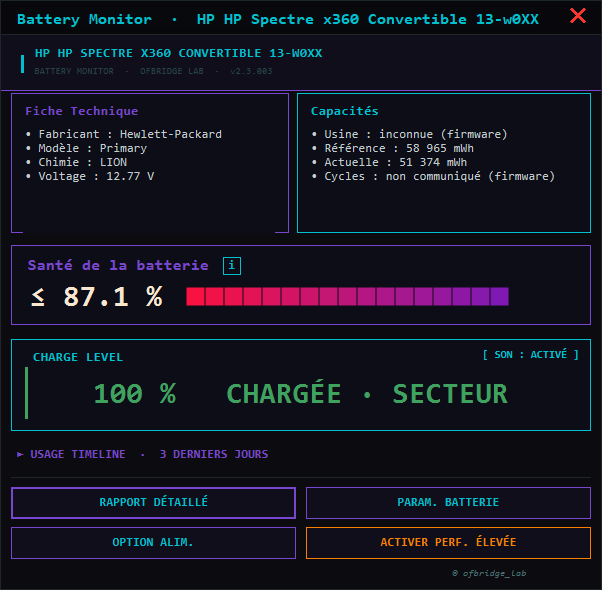
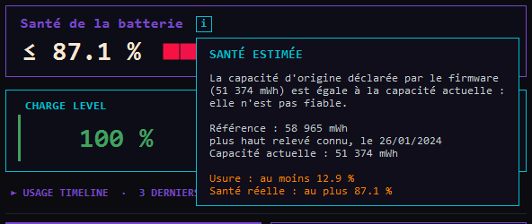
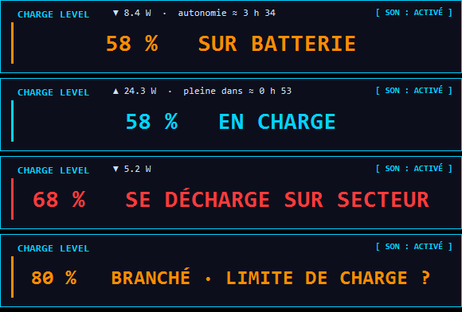
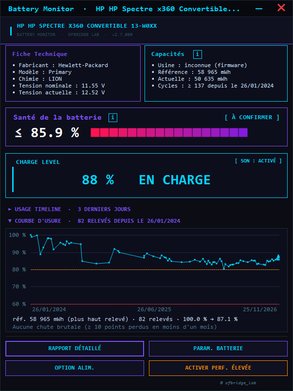

<div align="center">
  

# BATTERY MONITOR

**// LA VRAIE SANTÉ DE TA BATTERIE**

PowerShell + WinForms · 100 % natif Windows · interface Cyber-HUD

</div>

<p align="center">
  <a href="../../releases"></a>
  
  
  <a href="https://linktr.ee/ofbridgelab"></a>
</p>

---

Le **rapport batterie de Windows** est très complet, mais illisible. **BatteryInfoView** de NirSoft fait le travail, mais son interface a pris de l'âge. **Battery Monitor** affiche tout ce qui compte en un écran : **fiche technique**, **capacités**, **santé**, **charge en temps réel** et **historique d'usage sur 3 jours**. C'est un exe léger, open source, sans installation et sans droits administrateur.

> 🎯 **Certains firmwares affichent 100 % de santé alors que la batterie a perdu plus de 13 % de sa capacité. Battery Monitor détecte ce cas et donne la vraie valeur.**

<div align="center">
  
</div>

## 📑 Sommaire

- ✨ [Fonctionnalités](#-fonctionnalités)
- 🧠 [Une santé fiable, même quand le firmware se trompe](#-une-santé-fiable-même-quand-le-firmware-se-trompe) · 🔄 [Cycles estimés](#-cycles-estimés)
- 🔌 [États de charge](#-états-de-charge)
- 📊 [Historique d'usage sur 3 jours](#-historique-dusage-sur-3-jours)
- 📉 [Courbe d'usure](#-courbe-dusure)
- ⚡ [Accès rapides](#-accès-rapides)
- 📦 [Installation & utilisation](#-installation--utilisation)

---

## ✨ Fonctionnalités

- **Modèle exact du PC** : utile pour commander une pièce. Sur certains Asus (gamme Zenbook), il donne la lettre de référence qui manque souvent.
- **Fiche technique** : fabricant, modèle et chimie de la batterie, pour commander la bonne batterie de remplacement, avec sa **tension nominale** et sa **tension actuelle**, mise à jour en direct.
- **Capacités** : capacité d'origine, capacité réelle actuelle et nombre de cycles, **estimé** quand le firmware ne le communique pas.
- **Santé de la batterie** : pourcentage et barre de 20 segments, avec une bulle d'info **« i »** quand la valeur est estimée.
- **Verdict pour l'atelier** : **`[ BONNE ]`** (≥ 80 %), **`[ USÉE ]`** (60-79 %) ou **`[ À REMPLACER ]`** (< 60 %), en vert, ambre ou rouge. Quand la santé est estimée, seul ce qui est prouvé est affirmé : **`[ À CONFIRMER ]`** si une santé d'au moins 80 % ne peut pas être garantie. Les seuils s'affichent au survol.
- **Charge en temps réel**, rafraîchie toutes les 5 s, avec la **puissance en watts**, l'**autonomie restante** sur batterie et le **temps jusqu'à la charge complète** en charge (voir [États de charge](#-états-de-charge)).
- **Bip de fin de charge**, désactivable d'un clic (`[ SON : ACTIVÉ ]`).
- **Multi-batterie** : capacités et santé calculées sur l'ensemble des batteries, avec le détail par batterie.
- **Courbe d'usure** depuis le début de l'historique Windows, avec repérage des chutes brutales.
- **Interface Cyber-HUD** : fond sombre, accents néon, police Consolas, barre de titre noire avec boutons réduire (cyan) et fermer (rouge). On déplace la fenêtre en tirant la barre de titre, et **Échap** la ferme.

---

## 🧠 Une santé fiable, même quand le firmware se trompe

La santé d'une batterie se calcule normalement ainsi : **capacité actuelle ÷ capacité d'origine**. Mais certains firmwares (constaté sur un HP Spectre x360) **recopient la capacité actuelle dans la capacité d'origine**. Le calcul donne alors toujours **100 %**, alors que l'historique de Windows montre une batterie passée de 58 965 à 51 374 mWh.

Battery Monitor repère ce cas : une vraie capacité d'origine ne change jamais, alors que celle-ci varie d'un relevé à l'autre et suit la capacité actuelle. Dans ce cas :

- la référence devient la **plus haute capacité jamais relevée** ;
- la santé s'affiche comme un **maximum** (**« ≤ 87.1 % »**), puisque la batterie neuve contenait au moins cette référence ;
- la carte Capacités indique **« Usine : inconnue (firmware) »**, puis la référence retenue ;
- la bulle **« i »** donne le détail au survol.

<div align="center">
  
</div>

> 🔗 **Suite Ofbridge Lab** : la référence est aussi lue dans `batterie-historique.json`, écrit par **CyclObs** (dans `%ProgramData%\OfbridgeLab\Batterie\` ou `Historique\` à côté de l'exe). Elle est ainsi conservée même quand l'historique de Windows est effacé, par exemple après une réinstallation. Les numéros de série n'y sont jamais écrits en clair.

### 🔄 Cycles estimés

Beaucoup de firmwares renvoient **0 cycle** : la valeur n'est pas fournie, ce qui ne veut pas dire zéro cycle. Battery Monitor l'estime alors à partir de l'historique de Windows, qui note l'**énergie consommée sur batterie** pour chaque période. Un cycle correspond à une batterie pleine consommée, même en plusieurs fois.

- Affichage : **« Cycles : ≥ 137 depuis le 26/01/2024 »**. C'est un minimum, compté depuis le début de l'historique batterie de Windows (et non depuis l'installation de Windows) ;
- si la batterie a été remplacée, le comptage repart de la date du remplacement ;
- la bulle **« i »** de la carte Capacités détaille le calcul ;
- si le firmware donne un vrai nombre de cycles, c'est lui qui est affiché.

La valeur est **indicative**, pas au cycle près.

---

## 🔌 États de charge

Le bloc Charge indique le niveau, l'état et la puissance en direct : **▲** en charge, avec le temps jusqu'à la charge complète, et **▼** en décharge, avec l'autonomie restante.

| État | Couleur | Signification |
|---|---|---|
| **EN CHARGE** | 🟦 Cyan | La batterie charge |
| **CHARGÉE · SECTEUR** | 🟩 Vert | Pleine sur secteur, avec un bip de fin de charge (désactivable) |
| **SUR BATTERIE** | 🟧 Ambre | Chargeur débranché |
| **BRANCHÉ · LIMITE DE CHARGE ?** | 🟧 Ambre | Bloquée vers 60 % ou 80 % : en général un mode de préservation du constructeur, sans gravité |
| **BRANCHÉ · NE CHARGE PAS** | 🟥 Rouge | Ni charge ni décharge hors de ces zones : chargeur trop faible ou défaut |
| **SE DÉCHARGE SUR SECTEUR** | 🟥 Rouge | Branché mais la batterie se vide : chargeur sous-dimensionné, câble USB-C non PD ou connecteur |

Les états qui demandent une action ouvrent une bulle d'explication au survol.

Beaucoup de firmwares ne donnent pas la puissance. Battery Monitor la **mesure** alors lui-même, à partir de la baisse ou de la hausse de la charge restante (au bout de 2 à 5 minutes). En attendant, sur batterie, il estime l'autonomie avec la **consommation habituelle** du PC, tirée du rapport Windows (`▼ ≈ 9.3 W habituels`). Le « ≈ » signale une valeur estimée, et la bulle de la ligne en donne la source.

<div align="center">
  
</div>

---

## 📊 Historique d'usage sur 3 jours

Clique sur **► USAGE TIMELINE** pour déplier la frise des 3 derniers jours :

| Couleur | Signification |
|---|---|
| 🟦 **Cyan** | PC sur secteur |
| 🟧 **Orange** | PC sur batterie |
| ⬛ **Gris** | PC en veille |

Le survol d'une période affiche son détail.

<div align="center">
  
</div>

---

## 📉 Courbe d'usure

Clique sur **► COURBE D'USURE** pour voir l'évolution de la capacité de la batterie depuis le début de l'historique de Windows. Le niveau est exprimé en % de la référence utilisée pour la santé.

- Les repères en pointillés à **80 %** (ambre) et **60 %** (rouge) correspondent aux seuils du verdict.
- Une **chute brutale** (au moins 10 points perdus en moins d'un mois, confirmée sur les relevés suivants) est signalée en rouge. Une baisse passagère due à la jauge n'est pas signalée.
- Un **remplacement de batterie** interrompt la courbe et est indiqué par une ligne violette.
- Au survol, une bulle donne la date, la capacité et le % de chaque relevé.

La frise et la courbe fonctionnent en accordéon : déplier l'une replie l'autre, pour que la fenêtre tienne à l'écran.

<div align="center">
  
</div>

---

## ⚡ Accès rapides

| Bouton | Ouvre | Pour quoi faire |
|---|---|---|
| **RAPPORT DÉTAILLÉ** | Le rapport HTML complet de Windows (`powercfg /batteryreport`) | Historique des capacités depuis le début, estimations d'autonomie, données constructeur (nom, fabricant, numéro de série) |
| **PARAM. BATTERIE** | Les paramètres batterie de Windows 10 / 11 | Économiseur de batterie, consommation par application, graphique des dernières 24 h |
| **OPTION ALIM.** | Les options d'alimentation du panneau de configuration | Mode de performance, action à la fermeture du capot, délais de mise en veille |
| **ACTIVER PERF. ÉLEVÉE** | Le mode « Performances élevées », après confirmation | Le crée depuis le modèle Windows s'il est masqué sur l'appareil, puis l'active |

---

## 📦 Installation & utilisation

1. Télécharge `Battery_Monitor.exe` depuis l'onglet [**Releases**](../../releases).
2. Lance-le : aucune installation et aucun droit administrateur ne sont nécessaires.
3. La fenêtre s'ouvre au premier plan après quelques secondes, le temps que Windows génère son rapport batterie.

> [!TIP]
> Si tu utilises le script `.ps1` et qu'il est bloqué, ouvre PowerShell et lance :
> ```powershell
> Set-ExecutionPolicy RemoteSigned -Scope CurrentUser
> ```

## 🖥 Prérequis

- **Windows 10 ou 11**, 64 bits.
- **PowerShell 5.1**, inclus dans Windows.
- Un **ordinateur portable ou une tablette** avec batterie.

## 🧰 Notes techniques

- **Sources** : `powercfg /batteryreport` (versions HTML et XML), WMI `root\wmi` (`BatteryStatus`, `BatteryFullChargedCapacity`, `BatteryStaticData`), `Win32_PortableBattery` pour la tension nominale et `Win32_Battery` en secours. Optionnellement, `batterie-historique.json` écrit par CyclObs.
- **Rien n'est envoyé sur Internet** : tout est lu localement.
- **Rien n'est écrit sur le PC** : le réglage du son n'est pas mémorisé, et les rapports temporaires sont régénérés à chaque lancement.
- **Limite connue** : sans le cadre Windows, un clic sur l'icône de la barre des tâches restaure la fenêtre réduite, mais ne la réduit pas : utilise le bouton de réduction de la barre de titre.

## 📜 Historique des versions

Voir le [CHANGELOG](CHANGELOG.md) et les [Releases](../../releases).

## 📄 Licence

Projet sous licence **MIT** : voir le fichier [LICENSE](LICENSE).

---

<div align="center">
  <sub><a href="../../releases">Téléchargements</a> · <a href="https://linktr.ee/ofbridgelab">Linktree</a></sub>
  <br/>
  <sub><b>BATTERY MONITOR · OFBRIDGE LAB</b> · <i>// LA VRAIE SANTÉ DE TA BATTERIE</i></sub>
</div>
